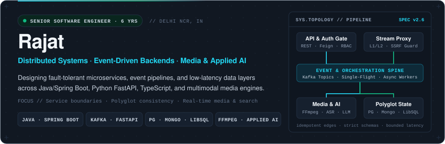
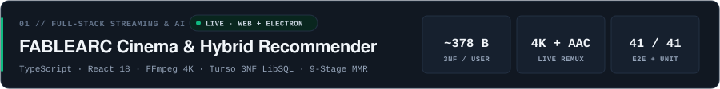
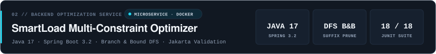
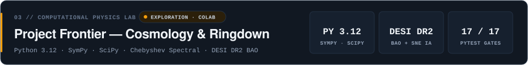
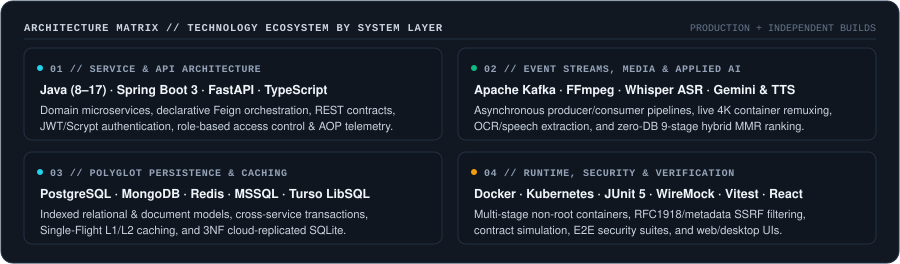
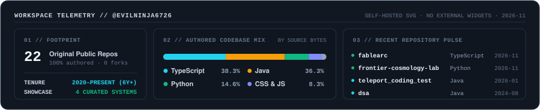

  <samp>
    delhi ncr, in &nbsp;·&nbsp;
    <a href="https://fablearc.vercel.app">fablearc.vercel.app ↗</a> &nbsp;·&nbsp;
    <a href="https://www.linkedin.com/in/rajat6726/">linkedin/in/rajat6726 ↗</a>
  </samp>

  <picture>
    <source media="(prefers-color-scheme: dark)" srcset="./assets/hero-dark.svg" />
    <source media="(prefers-color-scheme: light)" srcset="./assets/hero-light.svg" />
    
  </picture>

I'm a **Senior Software Engineer** with six years of experience designing backend architectures, event-driven pipelines, and media-intensive systems. Most of my professional work lives behind APIs—orchestrating Java/Spring Boot and Python FastAPI services, Apache Kafka event streams, polyglot data stores, and multimodal speech, vision, and media workflows where correctness under load matters more than novelty.

Outside day-to-day backend engineering, I enjoy building complete vertical systems end-to-end: from container-level `FFmpeg` media remuxing and zero-database hybrid recommendation engines to combinatorial optimization solvers and reproducible scientific simulations.

---

### Engineering Principles

- **Explicit boundaries over clever coupling** — Decompose services around clear domain ownership, keep inter-service contracts resilient to partial failure, and enforce idempotency where asynchronous streams meet stateful stores.
- **Storage matched to access patterns** — Use PostgreSQL when relational invariants and query plans dominate, MongoDB for evolving document graphs, Redis on hot read paths, and strict normalized SQLite/LibSQL replicas when sub-millisecond local reads beat network round-trips.
- **Security and observability at the perimeter** — Build SSRF filtering, sliding-window rate limiting, timing-safe authentication, input validation, and per-stage latency diagnostics into the core pipeline rather than bolting them on later.
- **Algorithmic grounding** — Classical data structures, pruning heuristics, and complexity bounds aren't just interview exercises; they directly decide whether a routing, ranking, or scheduling endpoint finishes in `2ms` or times out.

---

### Selected Systems & Explorations

<a href="https://github.com/evilninja6726/fablearc">
  <picture>
    <source media="(prefers-color-scheme: dark)" srcset="./assets/card-fablearc-dark.svg" />
    <source media="(prefers-color-scheme: light)" srcset="./assets/card-fablearc-light.svg" />
    
  </picture>
</a>

Full-stack cloud and desktop streaming platform combining an on-the-fly **FFmpeg 4K video-copy + multi-audio `AAC` remuxing pipeline**, a **Single-Flight L1/L2 caching proxy** hardened against RFC1918/IPv6/cloud-metadata SSRF, a **3NF SQLite + Turso LibSQL embedded replica** (`~378 bytes` per active user), and an in-memory **9-stage hybrid recommendation engine** with natural-language intent parsing and Maximal Marginal Relevance (MMR) diversity reranking.

<samp><a href="https://github.com/evilninja6726/fablearc">Repository ↗</a> &nbsp;·&nbsp; <a href="https://fablearc.vercel.app">Live Platform ↗</a> &nbsp;·&nbsp; TypeScript · React 18 · Node.js · Electron · FFmpeg · Turso LibSQL · Vitest</samp>

  

<a href="https://github.com/evilninja6726/teleport_coding_test">
  <picture>
    <source media="(prefers-color-scheme: dark)" srcset="./assets/card-smartload-dark.svg" />
    <source media="(prefers-color-scheme: light)" srcset="./assets/card-smartload-light.svg" />
    
  </picture>
</a>

Containerized **Spring Boot 3.2** microservice solving multi-dimensional freight load optimization under weight, volume, route/hazmat compatibility, and pickup-delivery window constraints. Partitions orders into compatible trip cohorts, sorts candidates by **payout-to-weight density**, and executes a bitmask **branch-and-bound DFS with precomputed suffix-sum pruning** to guarantee exact knapsack optimality without brute-force blowup.

<samp><a href="https://github.com/evilninja6726/teleport_coding_test">Repository ↗</a> &nbsp;·&nbsp; Java 17 · Spring Boot 3.2 · Jakarta Validation · Spring Actuator · JUnit 5 · Docker</samp>

  

<a href="https://github.com/evilninja6726/frontier-cosmology-lab">
  <picture>
    <source media="(prefers-color-scheme: dark)" srcset="./assets/card-frontier-dark.svg" />
    <source media="(prefers-color-scheme: light)" srcset="./assets/card-frontier-light.svg" />
    
  </picture>
</a>

Independent, AI-assisted computational physics exploration structured around reproducible numerical engineering: symbolic FLRW/Horndeski derivations and MCMC/Fisher identifiability benchmarks against **DESI 2024 BAO, SDSS DR16, and Union3 SNe Ia** covariance matrices (`PR-01`), alongside **Chebyshev spectral black-hole ringdown pseudospectrum** bounds (`PR-02`), automated BibTeX DOI/arXiv citation verification, and cloud-executable notebooks.

<samp><a href="https://github.com/evilninja6726/frontier-cosmology-lab">Repository ↗</a> &nbsp;·&nbsp;  &nbsp;·&nbsp;  &nbsp;·&nbsp; Python 3.12 · SymPy · SciPy · Pytest</samp>

  

<a href="https://github.com/evilninja6726/dsa">
  <picture>
    <source media="(prefers-color-scheme: dark)" srcset="./assets/card-dsa-dark.svg" />
    <source media="(prefers-color-scheme: light)" srcset="./assets/card-dsa-light.svg" />
    
  </picture>
</a>

Consolidated Java problem-solving repository spanning **461 implementations** across Codeforces rounds, LeetCode, and classic algorithmic domains—graph connectivity and shortest paths, dynamic programming, trees, heaps, binary search, and combinatorial backtracking.

<samp><a href="https://github.com/evilninja6726/dsa">Repository ↗</a> &nbsp;·&nbsp; Java · Data Structures · Graph Theory · Dynamic Programming · Competitive Programming</samp>

---

### Core Technology Ecosystem

  <picture>
    <source media="(prefers-color-scheme: dark)" srcset="./assets/systems-dark.svg" />
    <source media="(prefers-color-scheme: light)" srcset="./assets/systems-light.svg" />
    
  </picture>

---

### Workspace Telemetry

  <picture>
    <source media="(prefers-color-scheme: dark)" srcset="./assets/telemetry-dark.svg" />
    <source media="(prefers-color-scheme: light)" srcset="./assets/telemetry-light.svg" />
    
  </picture>

  
<samp>Architecture note: how this profile renders &amp; updates without third-party widgets</samp>

   
  <ul>
    <li><strong>Zero external stat servers:</strong> Every graphic on this page is a self-contained, repo-local SVG switched natively via HTML <code>&lt;picture&gt;</code> (<code>prefers-color-scheme</code>)—eliminating third-party Vercel uptime bottlenecks, rate-limit broken images, and visitor IP tracking.</li>
    <li><strong>Zero-dependency automation:</strong> <a href="./scripts/update_telemetry.py"><code>scripts/update_telemetry.py</code></a> uses only the Python 3.12 standard library and SHA-pinned GitHub Actions with least-privilege <code>GITHUB_TOKEN</code> permissions.</li>
    <li><strong>No manufactured commit noise:</strong> Telemetry SVGs are content-hash gated and committed as <code>github-actions[bot]</code> only when underlying repository metrics actually change—never inflating personal contribution graphs with daily no-op commits.</li>
  </ul>

